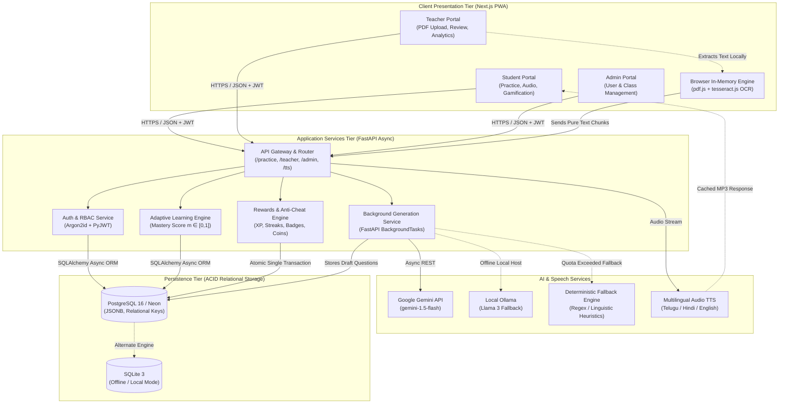
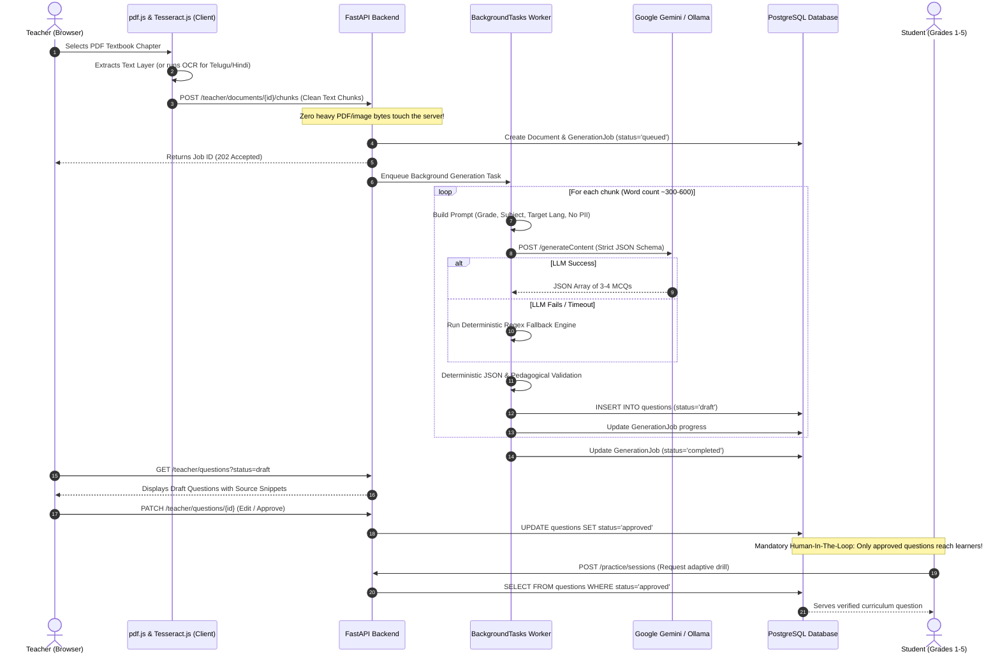
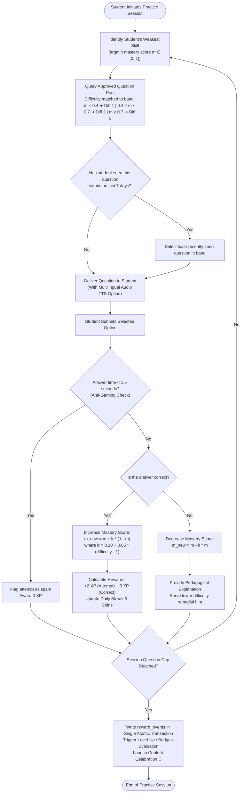

# LearnBridge — Technology Stack, Architectural Rationale & System Blueprints

This document details all technologies, frameworks, libraries, and architectural decisions powering the **LearnBridge** multilingual adaptive learning platform. It articulates the concrete engineering rationale for each choice, with visual Mermaid architecture diagrams illustrating the end-to-end operational flow.

---

## 1. Executive Summary & Design Principles

LearnBridge is engineered to bridge foundational literacy and numeracy gaps for primary school students (Grades 1–5) in India, adhering strictly to the pedagogical guidelines of **NEP 2020** and **NIPUN Bharat**.

The technical design is guided by four foundational constraints:
1. **₹0 Infrastructure Cost:** Must operate seamlessly on free tiers (Vercel, Neon, Google Gemini free tier) or completely offline/locally via Docker without recurring SaaS charges.
2. **Intermittent 3G & Low-End Hardware:** Sub-300ms question delivery, initial bundle $< 1.5\text{ MB}$, low RAM and battery footprint on budget 2GB Android smartphones.
3. **Multilingual Inclusivity:** Native script support for Telugu (`te`), Hindi (`hi`), and English (`en`), complete with audio text-to-speech for pre-readers.
4. **Child Safety & Pedagogical Quality:** Zero personally identifiable child information sent to external AI models; strict Human-In-The-Loop (HITL) teacher approval before any AI-generated question reaches a child.

---

## 2. Complete Technology Inventory & Rationale ("Why We Use It")

### 2.1 Frontend Tier (Client Application)

| Technology / Library | Version / Spec | Primary Responsibility | Architectural Rationale ("Why We Use It") |
|---|---|---|---|
| **Next.js** | `^14.2.18` (App Router) | Core Web Application Framework | Provides hybrid Static Site Generation (SSG) and Server-Side Rendering (SSR). The Next.js App Router enables directory-based role segregation (`/student`, `/teacher`, `/admin`), automated code-splitting, route pre-fetching, and fast load times on constrained mobile connections. |
| **React** & **React DOM** | `^18.3.1` | UI Component Engine | Industry standard declarative component model with Concurrent Features. Ensures reactive UI state management across gamified student sessions, audio player states, and interactive teacher dashboards. |
| **TypeScript** | `^5.6.3` | Type Safety & Developer Experience | Eliminates entire classes of runtime errors across complex multilingual question schemas, mastery matrices, and role-based API payloads through strict compile-time type verification. |
| **Tailwind CSS** | `^3.4.14` | Utility-First Styling Engine | Generates a minimal, purged CSS bundle ($< 50\text{ KB}$), crucial for budget Android phones on 3G networks. Custom design tokens allow seamless theme switching, high-contrast accessible touch targets ($\ge 48\text{ px}$), and playful kid-friendly color palettes. |
| **PostCSS** & **Autoprefixer** | `^8.4.47` / `^10.4.20` | CSS Post-Processing | Automates browser vendor prefixing across modern CSS specifications, guaranteeing cross-device layout consistency on budget browsers (Chrome Mobile, UC Browser, Android WebView). |
| **Lucide React** | `^0.453.0` | Accessible Iconography | High-clarity, tree-shakeable SVG icons. Provides intuitive visual cues (e.g., sound toggles, flame streaks, trophies, language switches) that assist early-grade learners who are still developing reading fluency. |
| **Canvas Confetti** | `^1.9.3` | Gamification Celebration VFX | Lightweight canvas-rendered particle celebration effects. Fires on session completion, level-up milestones, and badge achievements, reinforcing positive dopamine loops without sluggish DOM element bloat. |
| **clsx** & **tailwind-merge** | `^2.1.1` / `^2.5.4` | Class Concatenation & Deduplication | Ensures dynamic conditional class application without CSS precedence collisions, allowing seamless button state toggles (correct/incorrect/disabled) in rapid student drills. |
| **pdfjs-dist** | `^3.11.174` | Client-Side PDF Parsing | Extracts text layers directly inside the teacher's web browser. **Eliminates heavy backend PDF parsing workloads**, avoiding expensive server-side compute instances and preserving zero-cost hosting. |
| **Tesseract.js** | `^5.1.1` | Client-Side WebAssembly OCR | Runs Optical Character Recognition in the browser via WebAssembly using trained language packs (`tel`, `hin`, `eng`). Allows teachers to photograph or scan physical textbook pages without needing cloud vision APIs. |
| **Web Speech API & Custom TTS Bridge** | Native Browser API + FastAPI Proxy | Multilingual Text-to-Speech | Reads aloud question text, options, and explanations in Telugu, Hindi, or English. Essential for foundational learners (Grades 1–3) who understand spoken language better than complex written scripts. |

---

### 2.2 Backend Tier (Application Server & APIs)

| Technology / Library | Version / Spec | Primary Responsibility | Architectural Rationale ("Why We Use It") |
|---|---|---|---|
| **FastAPI** | `>=0.115.0` | High-Performance REST API Framework | Built on Starlette and Pydantic. Leverages Python asynchronous coroutines (`async`/`await`) to deliver sub-millisecond route dispatching, automatic OpenAPI (Swagger) documentation, and native dependency injection for database sessions and RBAC checks. |
| **Uvicorn [standard]** | `>=0.30.0` | Production ASGI Web Server | Lightning-fast asynchronous server implementation utilizing `uvloop` (event loop written in C) and `httptools`, maximizing throughput under concurrent student practice loads. |
| **Pydantic** & **Pydantic-Settings** | `>=2.8.0` / `>=2.4.0` | Request/Response Validation & Env Config | Enforces strict schema validation for question formatting, user inputs, and environment configurations. Catches malformed AI outputs before they reach the database layer. |
| **SQLAlchemy (v2.0)** | `>=2.0.32` | Async Object-Relational Mapper (ORM) | Provides database-agnostic asynchronous ORM queries, unit-of-work transactions, and relationship mapping between students, attempts, mastery states, and reward events. |
| **Psycopg 3 (psycopg[binary])** | `>=3.2.0` | PostgreSQL Driver | Next-generation asynchronous native driver for PostgreSQL, supporting connection pooling, binary protocol speed, and native JSONB serialization. |
| **aiosqlite** | `>=0.20.0` | Async SQLite Driver | Provides asynchronous SQLite execution. Enables developers and evaluators to run the entire backend locally with zero external database dependencies. |
| **PyJWT** | `>=2.8.0` | JWT Token Issuance & Verification | Generates signed, tamper-proof JSON Web Tokens containing user ID, role (`admin`, `teacher`, `student`), and class metadata. Enforces stateless 15-minute access and 7-day refresh token lifecycles. |
| **Argon2-cffi** & **Passlib / Bcrypt** | `>=23.1.0` / `>=1.7.4` | Cryptographic Password & PIN Hashing | Implements Argon2id (the winner of the Password Hashing Competition), providing maximum resistance against GPU/ASIC-based brute force cracking. Provides Bcrypt backward compatibility for legacy hashes. |
| **HTTPX** | `>=0.27.0` | Asynchronous HTTP Client | Async HTTP client used by the backend to communicate with external LLM APIs (Google Gemini, local Ollama) and speech services without blocking the main event loop. |
| **FastAPI BackgroundTasks** | Built-in Async Queue | Asynchronous Job Runner | Executes chunk-by-chunk LLM question generation in the background. **Bypasses the requirement for Celery and Redis**, saving significant RAM, hosting cost, and infrastructure complexity. |

---

### 2.3 Database Tier (Persistence & State Management)

| Technology | Engine / Specification | Primary Responsibility | Architectural Rationale ("Why We Use It") |
|---|---|---|---|
| **PostgreSQL 16 (Alpine)** | Relational Database (Docker / Local) | Primary Production Storage | Delivers strict ACID compliance, relational integrity (foreign keys, cascade deletes), and **JSONB columns** for storing dynamic question options and metadata. Alpine Linux base keeps the Docker image size under $40\text{ MB}$. |
| **Neon PostgreSQL** | Serverless Cloud PostgreSQL | Zero-Maintenance Cloud DB | Provides a generous free serverless PostgreSQL tier with instant branching and connection pooling, ideal for cloud deployment without server administration. |
| **SQLite 3** | File-Based Relational DB | Offline & Portable Mode | Embeds a zero-configuration database directly inside the repository (`learnbridge.db`). Ensures that demonstrations, workshops, and tests run out-of-the-box without Docker or cloud access. |

---

### 2.4 AI, LLM & Pedagogical Intelligence

| Technology / Component | Specification | Primary Responsibility | Architectural Rationale ("Why We Use It") |
|---|---|---|---|
| **Google Gemini API** | `gemini-1.5-flash` / `gemini-pro` | Multilingual Curriculum Item Generation | State-of-the-art multilingual comprehension across Indian languages (Telugu, Hindi, English). Generates high-quality pedagogical multiple-choice questions with targeted distractors and student explanations directly from curriculum chunks. |
| **Local Ollama** | `Llama 3` (8B) via Local Container | Offline / Air-Gapped Fallback | Enables private, completely local question generation when running in remote rural centers without internet access or when cloud API quotas are restricted. |
| **Deterministic Fallback Engine** | Custom Regex & NLP Heuristics | Zero-Failure Fallback System | If LLM API limits are reached, the system extracts grammar patterns, mathematical equations, and key vocabulary using regex heuristics to draft valid questions without crashing. |
| **Deterministic JSON Validator** | Custom Pydantic Guardrail | Structural & Security Gatekeeper | Validates raw LLM responses against strict rules (exactly 4 options, valid `correct_index` $0..3$, bilingual alignment, no child PII). Invalid questions are rejected before reaching teachers. |
| **Pure-Python Adaptive Engine** | Custom Pedagogical Algorithm | Dynamic Mastery & Question Selection | Real-time mastery formula ($m \in [0, 1]$), dynamic difficulty adjustment (Bands 1, 2, 3), and a 7-day recency filter. Pure-python implementation guarantees sub-5ms calculation latency with zero external dependencies. |

---

### 2.5 DevOps, Testing & Tooling

| Technology | Specification | Primary Responsibility | Architectural Rationale ("Why We Use It") |
|---|---|---|---|
| **Docker & Docker Compose** | Multi-Container Orchestration | One-Command Stack Deployment | Encapsulates frontend, backend, PostgreSQL, and optional Ollama containers with isolated networking and volume persistence (`pgdata`). Ensures uniform development and evaluation across Windows, macOS, and Linux. |
| **Pytest** & **Pytest-Asyncio** | `>=8.3.0` / `>=0.23.8` | Backend Automated Testing | Validates async API routes, mastery update algorithms, anti-gaming thresholds, and RBAC ownership isolation across 60+ automated test cases. |
| **Playwright** | `^1.64.1` | End-to-End Browser Testing | Automates multi-role user flows (student practice, teacher PDF review, admin user management) across Chromium, Firefox, and WebKit engines. |
| **Graphify** | Knowledge Graph & AST Mapper | Codebase Topology & Impact Analysis | Parses abstract syntax trees (AST) across the repository into an interconnected knowledge graph, enabling rapid architectural query and dependency tracking. |

---

## 3. System Architecture & Component Diagrams

### 3.1 3-Tier System Architecture Diagram

---

### 3.2 AI Content Pipeline (From Textbook PDF to Approved Question)

---

### 3.3 Adaptive Practice & Gamification Session Loop

---

## 4. Key Architectural Tradeoff Decisions (ADRs)

| ADR Reference | Decision Taken | Rejected Alternative | Core Engineering Justification |
|---|---|---|---|
| **ADR-1** | **PostgreSQL (with SQLite fallback)** | MongoDB / DynamoDB | Learning progress requires strict relational foreign keys (users $\rightarrow$ classes $\rightarrow$ sessions $\rightarrow$ attempts $\rightarrow$ skills). PostgreSQL JSONB provides NoSQL-like flexibility for storing 4-option question variants without sacrificing relational integrity. |
| **ADR-2** | **Client-Side PDF & OCR (pdf.js + tesseract.js)** | Backend PyMuPDF / Server Tesseract / Cloud Vision | Processing OCR and PDFs on a backend server demands massive CPU/RAM instances or expensive GPU cloud workers. Shifting this to the teacher's browser enables **₹0 backend hosting costs**. |
| **ADR-3** | **FastAPI BackgroundTasks** | Celery + Redis / RabbitMQ | Celery and Redis add $100\text{--}200\text{ MB}$ of memory overhead and require multi-container management. FastAPI's built-in background tasks run asynchronously within the main process at zero extra operational overhead. |
| **ADR-4** | **Rule-Based Adaptive Engine** | Heavy Deep Knowledge Tracing / Complex ML Models | Black-box neural models are non-deterministic, hard to audit for primary education, and computationally heavy. Our formula is transparent, mathematically provable, updates in $< 2\text{ ms}$, and can be seamlessly upgraded to Bayesian Knowledge Tracing (BKT) in v2. |
| **ADR-5** | **Mandatory Teacher Review (Human-In-The-Loop)** | Direct Automated Question Publishing | AI models occasionally hallucinate subtle factual errors. Because LearnBridge serves vulnerable young children (Grades 1–5), no generated item enters the active question pool until an educator reviews and approves it. |
| **ADR-6** | **Pre-Seeded Bilingual Question Bank Backbone** | Pure On-The-Fly AI Generation | Real classrooms frequently experience internet outages. LearnBridge includes an offline seed bank of curriculum-aligned questions in Telugu, Hindi, and English to guarantee uninterrupted learning. |

---

## 5. Security, Privacy & Compliance Architecture

1. **Child Data Protection (Zero PII to LLMs):** No child names, roll numbers, or school identifiers are ever injected into prompts sent to external LLMs. Prompts strictly contain curriculum text and pedagogical directives.
2. **Role-Based Access Control (RBAC):** Strict three-tier hierarchy (`Admin` $\rightarrow$ `Teacher` $\rightarrow$ `Student`). Every API route verifies both the role claim and resource ownership (e.g., teachers can only query their assigned class and students).
3. **Password & Credential Hardening:** Passwords hashed using memory-hard Argon2id. Young students can log in friction-free via secure Class Codes + numeric PINs.
4. **Append-Only Reward Ledgers:** To prevent tampering or gaming, XP, coins, and badges are written as immutable append-only logs in `reward_events`.

---

*Authored for the LearnBridge Architecture & Implementation Team.*
